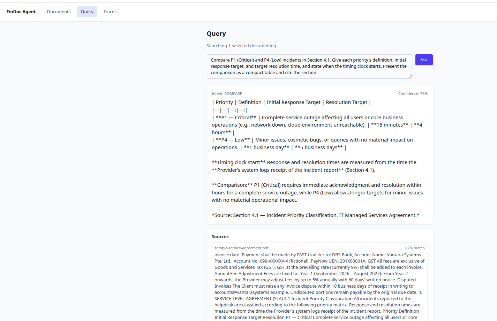
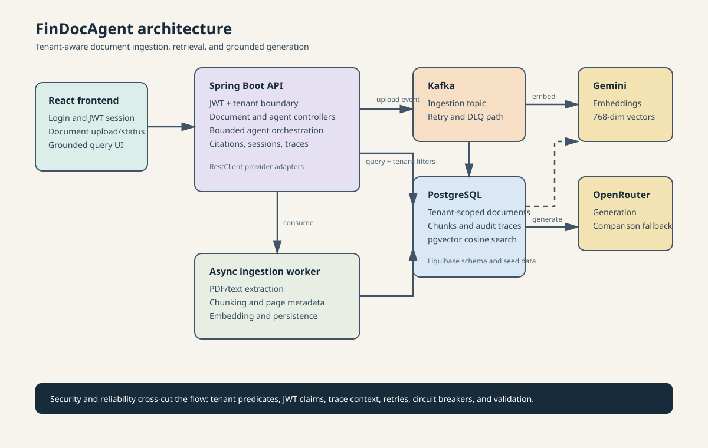
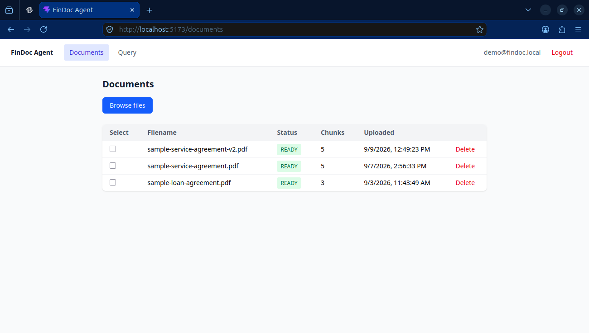
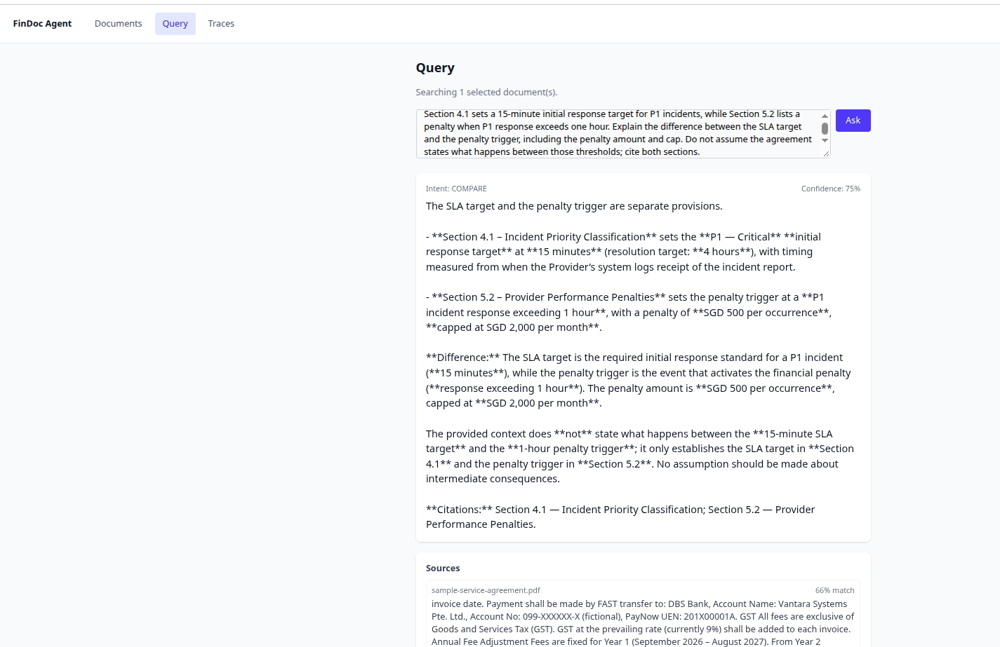
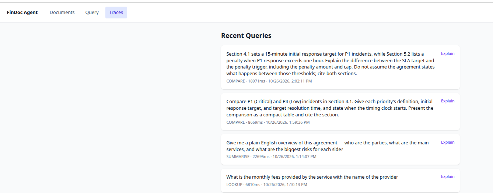
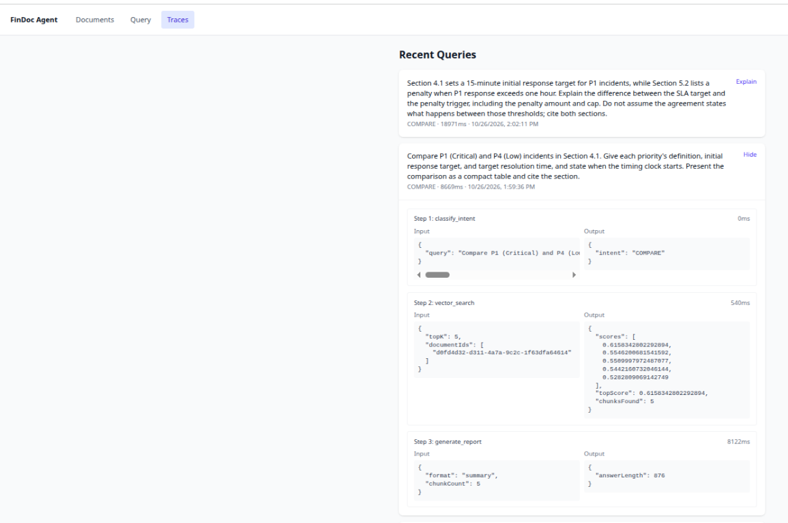

# FinDocAgent

FinDocAgent is a tenant-aware agentic RAG backend for ingesting financial documents, retrieving relevant content, and producing grounded responses with source citations. It is built with Spring Boot, PostgreSQL with pgvector, Apache Kafka, and pluggable LLM providers.

[](https://youtu.be/Wnl3h9jDs8c)

*Watch the demo: upload a financial document, ask a question, and inspect the cited answer and its trace.*

## Key Features

The feature set is deliberately shaped around the lifecycle of a financial document rather than a generic chatbot demo:

- **Secure tenancy first:** JWTs carry `tenant_id` and `user_id`; the request context and tenant-owned data access use those claims to enforce the isolation boundary a multi-customer document product needs.
- **Durable document intake:** PDF and text uploads are stored with status tracking, original-file download, soft deletion, and a 20 MB limit. The source remains auditable even while asynchronous processing is still running.
- **Asynchronous ingestion:** Kafka separates the upload request from extraction and indexing. Failed jobs are retried and routed to a dead-letter topic; tenant administrators can request replay. DLQ publication safety, replay, and metrics are implemented; production topic settings, permissions, and alerting still need deployment verification.
- **Retrieval-ready content:** Extracted text is split into chunks of up to 512 whitespace-delimited terms with 50-term overlap; this count uses whitespace splitting rather than a model tokenizer. PDF page counts are stored, but chunk-level page numbers are not currently assigned, so source citations may not include a page number.
- **Tenant-safe semantic search:** Gemini embeddings and PostgreSQL/pgvector cosine retrieval filter by tenant and selected documents, returning five sources by default. This keeps relevance useful without weakening authorization.
- **Inspectable query flow:** Queries use a fixed classify, retrieve, and generate pipeline with tenant-scoped session history, structured citations, and recorded stage traces.
- **Evidence-based comparison:** Comparison retrieves evidence independently for each requested document, reducing the risk that one document silently dominates the result.
- **Provider resilience:** Gemini handles embeddings while OpenRouter handles generation, with response validation, circuit breakers, and local fallback behavior for generation failures. Provider responsibilities stay explicit and replaceable.
- **Operational foundations:** Liquibase migrations, seeded local demo data, request logging with trace context, generated OpenAPI documentation with Swagger UI, tenant-scoped HTTP idempotency keys for uploads/queries/comparisons, and role-gated tenant-admin DLQ replay support the core workflow.

## Architecture

The diagram below shows the main request and data paths, including where the tenant boundary is enforced and where asynchronous processing begins.



The editable diagram source and a short explanation of the design decisions are in [docs/story-012-architecture-and-portfolio-positioning.md](docs/story-012-architecture-and-portfolio-positioning.md).

## Why I Built This (Singapore FinTech Focus)

I built FinDocAgent as a portfolio project targeted at Singapore's financial-services market. The domain is a useful test of production-minded document intelligence: financial teams need to find answers in regulated documents, retain evidence for review, and keep customer data isolated when the same platform serves multiple organizations.

That target shaped the architecture. The project treats multi-tenancy, auditability, asynchronous ingestion, source citations, provider failure, and bounded agent behavior as first-class concerns rather than polishing them after a chatbot prototype works. It is intended to show how an AI feature can fit into the controls, operational expectations, and document-heavy workflows common to Singapore fintech, banking, insurance, and compliance products.

## Product Tour

The frontend provides a focused workflow for uploading financial documents, monitoring ingestion, selecting source documents, and asking grounded questions with citations.

### Upload and Track Financial Documents

Upload documents, track processing status and chunk counts, and manage the tenant's document library from one view.



### Ask Questions, Get Cited Answers

Ask a precise question against the selected service agreement to compare P1 and P4 incident definitions, response targets, resolution targets, and the timing rule.


### Explainable Answers: See How Each Answer Was Built

For a follow-up that tests cross-section retrieval and careful interpretation, ask:

> **Section 4.1 sets a 15-minute initial response target for P1 incidents, while Section 5.2 lists a penalty when P1 response exceeds one hour. Explain the difference between the SLA target and the penalty trigger, including the penalty amount and cap. Do not assume the agreement states what happens between those thresholds; cite both sections.**



Both examples use the same agreement and selected-document query flow. Answers appear before the source cards; scroll below the answer to inspect the retrieved excerpts. The screenshots show the response text, detected intent, confidence, and source evidence.

The backend processes a query through three recorded stages, then persists the conversation and trace:

1. **classify_intent:** The system identifies what kind of question is being asked.
2. **vector_search:** It finds the most relevant passages in the selected documents while respecting the user's document access.
3. **generate_report:** It uses those passages and the current conversation context to produce a grounded answer with source citations.
4. **Persist the conversation:** The question and answer are saved so the session can continue naturally.
5. **Persist the trace:** The system records the intent, confidence, timings, and stage results so the answer can be reviewed later.

The Recent Queries page lists up to the user's five most recent queries. Selecting **Explain** opens the recorded `classify_intent`, `vector_search`, and `generate_report` stages, including their timings and a concise view of what each stage received and produced. This gives reviewers a practical explanation of how the answer was formed without exposing internal implementation details.





### Watch the Demo (Video)

Watch the [FinDocAgent demo recording](https://youtu.be/Wnl3h9jDs8c) for an overview of the document-intelligence workflow, from managing source documents to reviewing grounded answers and their supporting trace.

## Quick Start: Run Everything with Docker Compose

From the repository root, create the local environment file only if it does not already exist, then replace its placeholder `JWT_SECRET`:

```bash
cp -n findoc-agent/.env.example findoc-agent/.env
```

Start PostgreSQL with pgvector, Kafka, the Spring Boot backend, and the Vite frontend:

```bash
docker compose --env-file findoc-agent/.env up -d
docker compose --env-file findoc-agent/.env logs -f backend frontend
```

Open the frontend at http://localhost:5173. The backend health endpoint is http://localhost:8080/actuator/health and Swagger UI is http://localhost:8080/swagger-ui/index.html. PostgreSQL and Kafka are available to host tools on ports 5433 and 9093 by default; the backend uses Compose's internal service addresses. Set `FINDOC_POSTGRES_PORT` or `FINDOC_KAFKA_PORT` in the shell to change the published ports.

Stop the services while preserving database state:

```bash
docker compose --env-file findoc-agent/.env down
```

The database and uploaded-file volumes are removed only by `docker compose --env-file findoc-agent/.env down -v`; use that only when you intend to reset local data. This source-mounted development setup is not intended for production. Gemini-backed document ingestion requires a valid `GEMINI_API_KEY`; keep provider credentials in the ignored `.env` file, not in Compose YAML.

## Developer Guide

For prerequisites, local backend and frontend setup, configuration, public endpoints, OpenAPI/Swagger access, demo credentials, and validation commands, see the [developer runbook](findoc-agent/README.md).

### Backend tests

From the repository root, run the unit, Docker-backed integration, and distributed-systems correctness suites:

```bash
cd findoc-agent
JAVA_TOOL_OPTIONS="-Dapi.version=1.44" ./gradlew test integrationTest correctnessTest --console=plain
```

`test` runs the backend unit tests. `integrationTest` and `correctnessTest` run Docker-backed Testcontainers tests and require an accessible Docker socket. The `JAVA_TOOL_OPTIONS` setting provides Docker API compatibility for Docker 29/Testcontainers. In the verified environment, these suites passed 97 unit, 1 integration, and 38 correctness tests.

`localIntegrationTest` is a separate suite that requires a pre-existing local PostgreSQL test database and reachable Kafka. To run all four backend test tasks after those dependencies are ready:

```bash
JAVA_TOOL_OPTIONS="-Dapi.version=1.44" ./gradlew test integrationTest correctnessTest localIntegrationTest --console=plain
```

There is currently no configured frontend component-test runner. See the [developer guide](docs/dev-guide/README.md) for detailed test prerequisites and coverage.

## Project Status

FinDocAgent has locally validated core document-ingestion and query flows. The backend supports tenant-isolated JWT authentication, durable document uploads, Kafka ingestion with retry/DLQ handling, PDF and text extraction, whitespace-delimited chunking, Gemini embeddings, pgvector cosine retrieval, session-aware generation, citations, explain traces, document comparison, optional idempotency keys, and provider fallback resilience. The React frontend covers login, upload and document status management, document selection, grounded session-aware querying, and recent-query trace explanations. DLQ delivery safety, replay, metrics, and content-hash deduplication are implemented; production Kafka topic settings, permissions, and alerting still require deployment verification. See the [implementation status](docs/implementation-status.md).

## License

This project is licensed under the MIT License — see [LICENSE](LICENSE).
