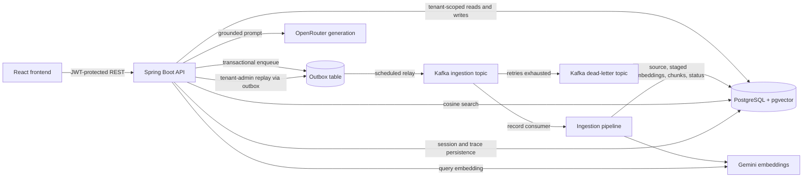
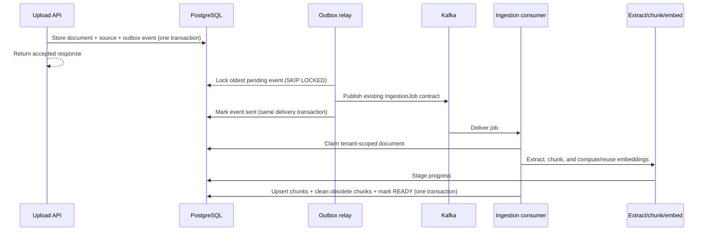

# Architecture and Design Overview

This is an implementation-oriented guide for reviewing FinDoc Agent's major runtime paths and the design patterns used to make them tenant-safe, retryable, and inspectable. It describes the current implementation rather than a target-state proposal. Detailed decisions and operational procedures are linked where they are documented elsewhere.

## System at a glance

FinDoc Agent is a tenant-aware document RAG application. A React frontend calls a stateless Spring Boot API. PostgreSQL is the source of truth for tenant-owned data, document status, source files, chunks, embeddings, request idempotency, and query history. Kafka separates upload acceptance from document processing. Gemini generates embeddings; OpenRouter generates answers and comparisons.

### Main code boundaries

| Boundary | Responsibility |
|---|---|
| Controllers and DTOs | HTTP contract, validation, status codes, and optional idempotency handling |
| Services | Document lifecycle, ingestion orchestration, authentication, agent query/comparison, replay, and provider integration |
| Repositories and entities | Tenant-scoped persistence and database-enforced state transitions |
| Messaging | Ingestion event contract, outbox relay, Kafka consumer/producer, retry and dead-letter handling |
| PostgreSQL and Liquibase | Durable business state, pgvector search, constraints, indexes, and schema evolution |
| React frontend | Upload, document status, grounded queries, comparisons, and trace review |

The [architecture diagram](./architecture-diagram.svg) provides a visual component view. The [root README](../README.md) is the user-facing product and local-run overview.

### Java business-logic entry points

The controllers adapt HTTP requests to service operations; the services below own the main application decisions. Repository and messaging collaborators are listed where they form an important part of a cross-layer workflow.

| Layer / business capability | Main Java classes | Responsibility |
|---|---|---|
| HTTP API | [`DocumentController`](../findoc-agent/src/main/java/com/findoc/controller/DocumentController.java), [`AgentController`](../findoc-agent/src/main/java/com/findoc/controller/AgentController.java), [`AuthController`](../findoc-agent/src/main/java/com/findoc/controller/AuthController.java), [`AdminDlqReplayController`](../findoc-agent/src/main/java/com/findoc/controller/AdminDlqReplayController.java) | Validate and route document, agent, authentication, and tenant-admin replay requests to application services. |
| Authentication | [`AuthService`](../findoc-agent/src/main/java/com/findoc/service/auth/AuthService.java), [`JwtService`](../findoc-agent/src/main/java/com/findoc/service/auth/JwtService.java) | Authenticate users and issue/validate signed JWTs containing tenant, user, and role claims. |
| Document lifecycle | [`DocumentService`](../findoc-agent/src/main/java/com/findoc/service/document/DocumentService.java) | Validate uploads, deduplicate tenant-owned content, persist document/source state, enqueue ingestion, and implement status, download, listing, and soft deletion. |
| Ingestion orchestration | [`IngestionService`](../findoc-agent/src/main/java/com/findoc/service/document/IngestionService.java), [`ChunkingService`](../findoc-agent/src/main/java/com/findoc/service/document/ChunkingService.java), [`DocumentTextExtractor`](../findoc-agent/src/main/java/com/findoc/service/document/DocumentTextExtractor.java), [`PdfExtractionService`](../findoc-agent/src/main/java/com/findoc/service/document/PdfExtractionService.java) | Claim and process jobs; extract text, chunk it, stage embeddings, and coordinate completion. The claim, progress, and completion services isolate short transactional state changes. |
| Ingestion state and recovery | [`IngestionClaimService`](../findoc-agent/src/main/java/com/findoc/service/document/IngestionClaimService.java), [`IngestionProgressService`](../findoc-agent/src/main/java/com/findoc/service/document/IngestionProgressService.java), [`IngestionCompletionService`](../findoc-agent/src/main/java/com/findoc/service/document/IngestionCompletionService.java), [`StaleIngestionRecoveryService`](../findoc-agent/src/main/java/com/findoc/service/document/StaleIngestionRecoveryService.java) | Apply conditional claims/failure transitions, persist retryable embedding progress, finalize chunks and READY state, and requeue expired processing claims. |
| Agent query and comparison | [`AgentService`](../findoc-agent/src/main/java/com/findoc/service/agent/AgentService.java), [`IntentClassifier`](../findoc-agent/src/main/java/com/findoc/service/agent/IntentClassifier.java) | Classify intent, retrieve tenant-scoped evidence, coordinate session context and generation, persist messages/traces, and compare two documents using separate evidence retrieval. |
| Embedding provider | [`EmbeddingService`](../findoc-agent/src/main/java/com/findoc/service/embedding/EmbeddingService.java), [`GeminiEmbeddingService`](../findoc-agent/src/main/java/com/findoc/service/embedding/GeminiEmbeddingService.java) | Define the embedding boundary and call Gemini for document/query vectors. |
| Answer generation and provider resilience | [`OpenRouterGenerationService`](../findoc-agent/src/main/java/com/findoc/service/agent/OpenRouterGenerationService.java), [`ProviderCircuitBreaker`](../findoc-agent/src/main/java/com/findoc/service/ProviderCircuitBreaker.java) | Call OpenRouter for grounded answers/comparisons and fall back to local generation when live generation is unavailable. The circuit breaker guards provider calls. |
| Request idempotency | [`IdempotencyExecutor`](../findoc-agent/src/main/java/com/findoc/service/idempotency/IdempotencyExecutor.java), [`RequestFingerprint`](../findoc-agent/src/main/java/com/findoc/service/idempotency/RequestFingerprint.java) | Reserve tenant-scoped keys, compare request fingerprints, persist the original response with the operation, and replay it on a matching retry. |
| Dead-letter replay | [`DlqReplayService`](../findoc-agent/src/main/java/com/findoc/service/document/DlqReplayService.java) | Authorize replay through the tenant-scoped document state transition and enqueue a reconstructed job; the controller enforces the admin route role. |
| Messaging and outbox delivery | [`IngestionOutbox`](../findoc-agent/src/main/java/com/findoc/messaging/IngestionOutbox.java), [`OutboxDelivery`](../findoc-agent/src/main/java/com/findoc/messaging/OutboxDelivery.java), [`OutboxRelay`](../findoc-agent/src/main/java/com/findoc/messaging/OutboxRelay.java), [`KafkaIngestionConsumer`](../findoc-agent/src/main/java/com/findoc/messaging/KafkaIngestionConsumer.java), [`KafkaIngestionProducer`](../findoc-agent/src/main/java/com/findoc/messaging/KafkaIngestionProducer.java) | Persist ingestion events, relay them to Kafka, consume ingestion jobs, and publish with confirmed producer results. `KafkaConfiguration` defines retry, acknowledgment, and dead-letter behavior. |

## Tenant and request boundary

1. Authentication issues a signed JWT carrying `tenant_id`, `user_id`, and role claims.
2. The security filter validates the token, derives the tenant and user identities, and installs them in request-scoped context. Admin routes require the `ADMIN` role.
3. Services use the authenticated context rather than accepting a caller-supplied tenant identifier. Persistence lookups and state-changing queries include tenant predicates; session and trace operations also scope to the authenticated user where applicable.
4. The trace filter uses the incoming `X-Trace-Id`, or generates one when absent, returns it in the response, and places trace, tenant, and user identifiers in MDC for request logging.

Tenant isolation is enforced in application access paths and reinforced by database constraints where appropriate; it is not implemented as a separate database/schema per tenant. A cross-tenant result is not an intended fallback behavior: tenant-scoped lookups return not found when the record is outside the caller's scope.

## Document upload and ingestion

### Upload acceptance

The upload endpoint validates supported file types and non-empty content, finds the authenticated tenant's user, hashes the bytes, and checks for a live tenant-scoped duplicate. A new upload creates the document metadata, original source bytes, and an `IngestionJob` outbox row in one PostgreSQL transaction. The API can return `202 Accepted` without waiting for Kafka or the embedding provider.

Tenant-scoped content-hash deduplication reuses the existing live document; if that duplicate is `FAILED`, the service conditionally returns it to `PENDING` and enqueues another job. Document deletion is soft deletion and also hides its live chunks from retrieval.

### Processing

The Kafka consumer passes each job to an ingestion pipeline. The service validates that the document belongs to the job's tenant and that the recorded user owns it, then conditionally claims the document as `PROCESSING`. Text extraction and chunking run before embeddings are generated. Chunking uses a maximum of 512 whitespace-separated terms with a 50-term overlap; this is not a model tokenizer.

Successful embeddings are staged durably per document/chunk and reused on retries only when the staged text still matches. Provider calls are outside the final database completion transaction. Completion upserts the live chunk set, soft-deletes obsolete trailing chunks, removes staged progress, and marks the document `READY` atomically. PostgreSQL uniqueness and conditional tenant/status updates protect concurrent or repeated deliveries. A duplicate delivery for a `READY` document is a no-op; a fresh `PROCESSING` claim is not silently treated as completed.

The high-level processing path is:

## Transactional outbox: atomicity boundary and delivery semantics

The outbox closes the database/Kafka dual-write gap at upload time:

- The document, source bytes, and serialized ingestion job are committed together. A rollback leaves none of them visible; a committed upload always leaves a durable event to relay.
- The outbox row stores tenant attribution and a JSONB payload using the existing `IngestionJob` message contract. The destination topic remains configuration owned by the producer rather than duplicated in each row.
- A scheduled relay polls a bounded batch (defaults: 1 second and 20 events). For each event, it selects the oldest pending row using `SELECT ... FOR UPDATE SKIP LOCKED`, publishes synchronously through the existing producer, then updates `sent_at`. These operations run in one Spring-managed database transaction.
- Concurrent relay invocations or application instances skip rows already locked by another delivery. A failed send leaves the row pending for a later poll; it does not turn an already committed upload into an upload failure.

This is **at-least-once**, not exactly-once delivery. PostgreSQL and Kafka do not share an atomic commit: Kafka may acknowledge a message and the process may fail before the `sent_at` transaction commits. The relay can then publish the event again. The design intentionally favors possible duplicate work over losing a committed event; consumer-side conditional claims, uniqueness constraints, upserts, and `READY` no-op handling make duplicate ingestion safe. It does not claim that every external side effect is exactly once.

The outbox relay holds a database row lock and transaction while waiting for Kafka publication. This keeps send and sent-marker ordering simple, but means broker latency consumes a database connection/lock for that event. A poison or repeatedly failing oldest event is left pending and retried; the current relay stops its poll after a delivery exception, and that same oldest row can block later rows from that relay across polls until it succeeds or is otherwise resolved. See the [outbox implementation handoff](./story-017-transactional-outbox.md) and [outbox design decisions](./story-017-transactional-outbox-design-decisions.md).

### Retry, recovery, and dead-letter path

Consumer failures use bounded exponential backoff and record-level acknowledgment. After configured retries are exhausted, the recovery path publishes the record to `findoc.ingestion.dlq` before recording the exhausted failure; publication errors are configured to fail rather than silently discard the message. Malformed payloads are routed through the error-handling deserializer path. DLQ records carry retry-count metadata when a valid ingestion job is available.

Ingestion also writes progress heartbeats. A bounded stale-claim scan can reset a still-expired `PROCESSING` document and enqueue its recovery job through the same outbox transaction. Manual replay is tenant-admin-only: it reconstructs the job from the tenant-owned document, conditionally changes `FAILED` to `PENDING`, and enqueues through the outbox. A repeated replay while already `PENDING` does not enqueue a second event.

The code configures DLQ topic partition, replication, and retention values, but effective production topic settings, permissions, and deployment alerts still require environment verification. See [Audit 2 ingestion idempotency](./story-018-audit-2-ingestion-idempotency-design-decisions.md) and [DLQ replay decisions](./story-020-dlq-replay-design-decisions.md).

## Query, retrieval, and comparison

The query endpoint follows a fixed pipeline rather than an open-ended autonomous tool loop:

1. A deterministic, rule-based classifier assigns `LOOKUP`, `COMPARE`, `SUMMARISE`, or `REPORT`.
2. Gemini embeds the query. A parameterized PostgreSQL/pgvector query ranks chunks with cosine distance (`<=>`), filters by tenant, soft-deleted state, and optionally the selected document IDs, and returns a bounded top-K (default 5).
3. When continuing an existing session, the service uses up to 10 recent messages from the authenticated user's tenant-scoped session as generation context, then asks the generation service to answer using the retrieved passages.
4. The service persists user/assistant messages and a structured query trace, then returns citations/sources with the response.

Comparison validates two distinct, ready documents and retrieves evidence independently for each document before generating the comparison. This avoids one document's chunks crowding out the other's evidence. Query traces record stage names, bounded inputs/outputs, and timings for later explanation.

The [vector retrieval strategy](./vector-search-and-retrieval-strategy.md) documents the query shape, index, and retrieval details. It is an implementation-specific companion to this overview.

## Other implemented design patterns

| Pattern | Where it appears | Purpose and boundary |
|---|---|---|
| Layered, dependency-injected services | Controllers, services, repositories, messaging, providers | Keeps HTTP, orchestration, persistence, and external calls separate and testable. |
| Tenant-scoped data access | JWT filter, `TenantContext`, services and repository predicates | Uses authenticated tenant/user identity for reads and mutations; request payloads do not select another tenant. |
| Transactional outbox + competing consumers | Upload/replay/recovery and scheduled relay | Makes event creation atomic with database state; `SKIP LOCKED` distributes pending rows among relay instances. |
| Idempotency-key response replay | Upload, agent query, and comparison endpoints | Optional tenant/key reservation and original response are stored with the business operation. Same fingerprint replays the stored status/body; a different request under the same key conflicts. Keys expire after 24 hours. |
| Conditional state transitions and database uniqueness | Ingestion claims/completion, replay, live chunk writes | Lets PostgreSQL arbitrate races and protects state invariants under duplicate delivery. |
| Durable checkpoint/staging | Ingestion progress table | Reuses completed embeddings after a retry when content is unchanged; staged data is not used by retrieval and is removed on successful completion. |
| Circuit breaker with local generation fallback | Gemini/OpenRouter provider integration | Stops repeated calls while the provider circuit is open; generation can fall back to a local summary/comparison. Embedding failures still follow ingestion retry/failure handling. |
| Soft deletion and tenant-scoped content deduplication | Documents and chunks | Preserves source/history while excluding deleted records from normal list and retrieval paths; content hashes avoid duplicate live uploads within a tenant. |
| Structured audit/explain trace | Agent query and comparison | Persists the pipeline stages and timing separately from the answer so reviewers can inspect how a result was formed. |

Idempotency does not cover every API. Its supported writes are upload, query, and comparison; it is optional for clients, tenant-scoped, expires after 24 hours, and stores the status and JSON body rather than byte-identical HTTP headers. See [tenant-scoped idempotency decisions](./story-019-idempotency-design-decisions.md).

## Failure and consistency model

| Boundary | Guarantee | Remaining limitation |
|---|---|---|
| Upload DB commit | Document, source, and outbox event commit or roll back together | Does not atomically commit with Kafka. |
| Outbox-to-Kafka | Failed publication remains eligible for retry | Duplicate publication is possible if Kafka accepts before the DB sent marker commits. |
| Kafka-to-ingestion | Retries, conditional claims, staged progress, and idempotent chunk writes support redelivery | Provider calls can fail; stale recovery is lease-based and needs production timeout tuning. |
| Chunk publication | Final live chunk refresh and `READY` transition commit together | Embedding staging consumes storage during retries; a cleanup policy for permanently stranded staging data is a separate operational concern. |
| Agent generation | Provider timeouts/circuit breakers and local generation fallback keep a generation response path available | Local fallback is a bounded summary, not equivalent to a live model answer; embeddings still require the embedding provider. |
| Tenant boundary | Authenticated identities and tenant predicates constrain application access | Correctness depends on maintaining tenant predicates in future repository and service paths. |
| Query citations | Retrieved chunks are returned as sources | PDF page counts are persisted, but chunk-level page numbers are not currently populated. |

## Operational and review notes

- Database schema is managed by Liquibase; Hibernate validates rather than creates the schema.
- The application exposes health, info, and metrics endpoints. DLQ publication has a counter, while circuit-breaker metrics remain an optional deployment-driven follow-up.
- Agent query and comparison orchestration are transactional across retrieval, provider calls, and persistence. In contrast with ingestion, provider calls are not explicitly separated from the database transaction; review transaction duration under slow provider responses.
- Review configured ingestion lease, retry/backoff, DLQ retention/replication, Kafka permissions, and alerting against the production environment; local defaults are not evidence of effective production settings.
- Unit tests cover service and controller behavior; the `correctnessTest` suite exercises database/Kafka boundaries using containers, and local integration tests exercise configured local infrastructure. See [test suite readiness](./story-023-test-suite-readiness.md).
- The implementation-status index records current validation and remaining deployment work: [implementation status](./implementation-status.md).

## Documentation handoff

- **Completed:** Added an as-built system overview covering runtime boundaries, upload/ingestion, the outbox, retrieval/agent flow, cross-cutting patterns, consistency guarantees, and operational caveats.
- **Pending:** Keep this guide aligned when major runtime boundaries or reliability guarantees change; complete the production Kafka/DLQ configuration and alerting verification tracked by the implementation status.
- **Validation performed:** Reviewed the overview against the current Spring services, controllers, repositories, Kafka and schema-management configuration, and linked design records; verified the local documentation references.
- **Next item:** Verify production DLQ topic settings, permissions, and alerting as recorded in the implementation-status index.
